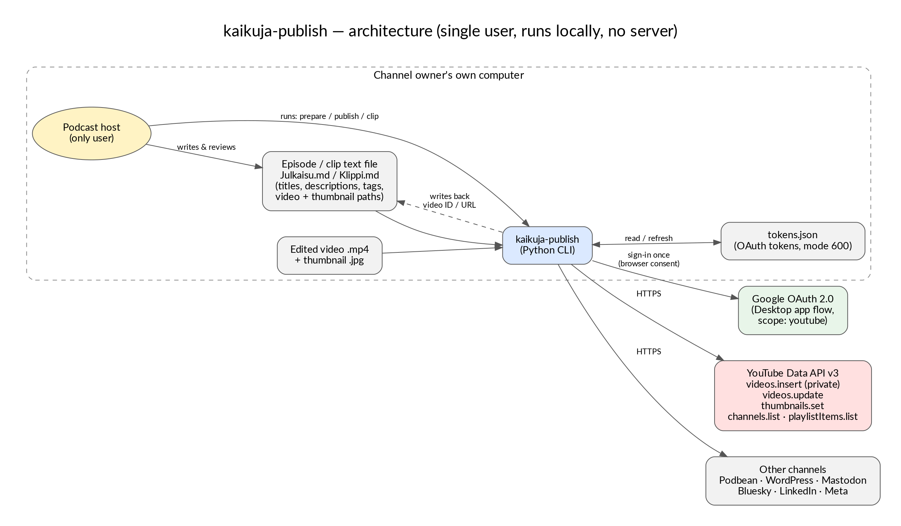
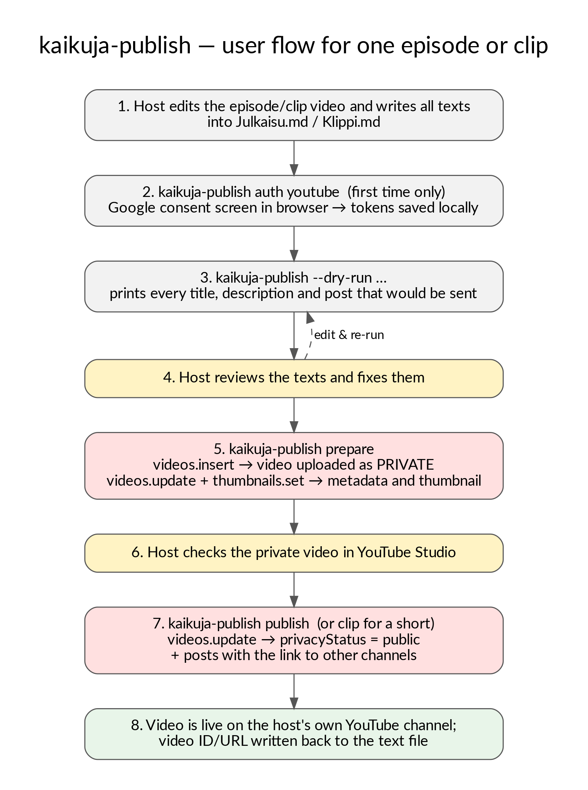

# kaikuja-publish

A personal command-line tool that publishes episodes and short clips of the Finnish podcast
**[Kaikuja Kaikkeudesta](https://www.kaikkeudenkartano.fi/)** ("Echoes from the Universe") to
YouTube, Podbean, WordPress and social media, from one reviewed text file.

It is written and used by one person — the podcast's host, Tuukka Pitkänen — on his own
computer, for his own channels. It has no other users and no server component.

- **Privacy policy:** <https://pitkanentuukka.github.io/kaikuja-publish/privacy.html>
- **Terms of use:** <https://pitkanentuukka.github.io/kaikuja-publish/terms.html>
- **License:** MIT

## YouTube API Services

This tool uses **YouTube API Services**. By using it you agree to be bound by the
[YouTube Terms of Service](https://www.youtube.com/t/terms); see also the
[Google Privacy Policy](https://policies.google.com/privacy).

It signs in to the owner's own YouTube channel with OAuth 2.0 (desktop/installed-app flow,
scope `https://www.googleapis.com/auth/youtube`) and calls only these endpoints:

| Endpoint | Used for |
|---|---|
| `videos.insert` | upload the finished episode or clip — always as **private** |
| `videos.update` | set title, description, tags, category and language; later switch the video to **public** |
| `thumbnails.set` | set the episode's custom thumbnail |
| `channels.list` (`mine=true`) | find the channel's uploads playlist |
| `playlistItems.list` | list the channel's 5 latest uploads (fallback when the video was uploaded by hand in YouTube Studio) |

It does not read, download, store or analyse any other YouTube content or any other user's data.
Typical use is one episode and a few clips per month (well under 1,000 API requests per day).

## How it works

```
Julkaisu.md / Klippi.md      ← all texts for one episode or clip, reviewed by the host
        │
kaikuja-publish prepare      → uploads the video to YouTube as private, sets metadata + thumbnail,
                               creates Podbean and WordPress drafts
        │  (host checks the private video in YouTube Studio and the drafts)
kaikuja-publish publish      → switches the YouTube video to public, publishes the drafts,
                               posts to Mastodon, Bluesky, LinkedIn, Facebook page, Instagram, Threads
kaikuja-publish clip         → same for a short vertical clip (YouTube Shorts + social media)
```

Every completed step writes its ID/URL back to the text file's front matter, so an interrupted
run can be repeated safely. `--dry-run` shows everything that would be sent without sending it.





## Setup

```bash
pip install requests
cp .env.example ~/bin/.env      # or set KAIKUJA_PUBLISH_ENV=/path/to/.env
chmod 600 ~/bin/.env            # fill in the credentials you need
kaikuja-publish auth youtube    # OAuth sign-in in the browser
kaikuja-publish check           # shows which channels are configured
```

For YouTube, create a Google Cloud project, enable *YouTube Data API v3* and create an OAuth
client of type *Desktop app*; put its ID and secret in `.env`. Uploading with `videos.insert`
is enabled with `YOUTUBE_UPLOAD=1`.

OAuth tokens are stored only on the local machine in `~/.config/kaikuja-publish/tokens.json`
(file mode 600). Access can be revoked at any time at
<https://myaccount.google.com/permissions>; deleting that file removes the local copy.

Comments and command output in the script are in Finnish, the language of the podcast.
